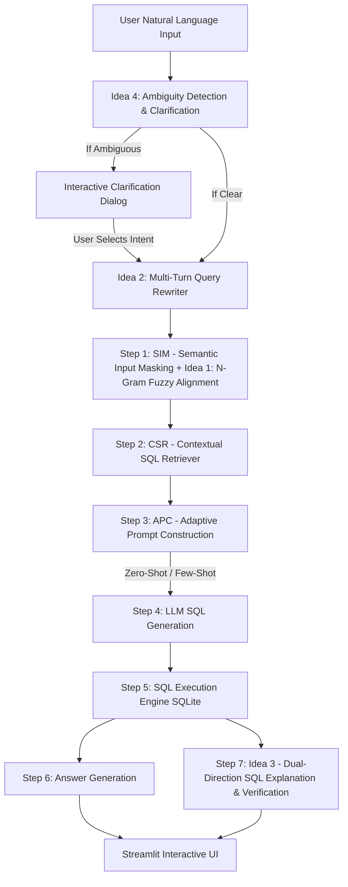

# ADEPT-SQL Enhanced: Explainable, Robust & Context-Aware Text-to-SQL System

## Executive Summary & Project Overview
This project presents an end-to-end enhancement of the **ADEPT-SQL** (Adaptive Prompting and Example Selection for Text-to-SQL) framework. While baseline Text-to-SQL architectures convert natural language questions into executable database queries using Large Language Models (LLMs), real-world deployment reveals significant vulnerabilities:
1. **Typo sensitivity:** Minor spelling mistakes in names, stores, or entity mentions cause database lookups to fail silently or yield empty results.
2. **Context amnesia:** Conversational queries with pronouns (e.g., *"What are their email addresses?"*, *"How many are there?"*) lose reference to previous turns.
3. **Black-box execution:** Standard pipelines return raw tables without explaining the underlying query logic or verifying whether user constraints were satisfied.
4. **Unchecked semantic ambiguity:** Underspecified queries (e.g., *"Show me the top bookings"*) force the model to guess arbitrary ranking criteria rather than confirming the user's intent.

To address these challenges, we engineered **four innovative NLP enhancements** integrated into the core ADEPT pipeline with interactive visualization via a **Streamlit** user interface.

---

## 1. System Architecture & ADEPT-SQL Pipeline

### Baseline ADEPT-SQL Modules:
- **SIM (Semantic Input Masking):** Masks date expressions and domain-specific terms into abstract category slots (`[Customer Name]`, `[Store Name]`) to improve pattern matching.
- **CSR (Contextual SQL Retriever):** Computes dense semantic embeddings using Sentence-Transformers (`all-MiniLM-L6-v2`) against stored Question-SQL pairs in `qvec.csv`.
- **APC (Adaptive Prompt Construction):** Dynamically decides whether to use Few-Shot imitation (if similarity $> 0.85$) or Zero-Shot generation with full schema metadata (`dbmata.csv`).
- **SQL Execution & Response:** Executes the generated query against SQLite (`cre_Drama_Workshop_Groups.sqlite`) and generates a conversational natural language summary.

---

## 2. Core Enhancements & Innovations Implemented

### 🌟 Idea 1: Typo-Tolerant Sliding-Window Fuzzy Entity Alignment in SIM
- **The Problem:** In standard systems, domain entity recognition is exact-match only. If a user mistypes an entity (e.g., *"Did Blak book Adan Dinnig?"*), standard masking fails, vector similarity drops, and the generated SQL queries for non-existent entities, returning 0 rows.
- **Our Innovation:** Implemented **sliding-window n-gram fuzzy entity matching** (`difflib.SequenceMatcher`) directly inside the SIM module:
  - Multi-word entities (e.g., `Adan Dinning`, `Shery Photo`, `Fred Dinning`) are recognized using variable-length token windows down to single words.
  - Automatically identifies candidate spans, normalizes typos (`Blak` $\rightarrow$ `Blake`, `Adan Dinnig` $\rightarrow$ `Adan Dinning`), injects canonical entity values into prompt hints, and masks the text with column descriptors.
  - Implemented stopword guardrails (`list`, `show`, `find`, `tell`, `group`, etc.) to prevent common query verbs from false-positive matches.
- **Visual UI Proof:** A prominent info badge highlights detected typos and canonical alignments:
  > `🔍 SIM Typo Alignment: Auto-corrected entity: Blak ➔ Blake (Customer_Name) · Adan Dinnig ➔ Adan Dinning (Store_Name)`

---

### 🌟 Idea 2: Multi-Turn Conversational Memory & Context-Aware Query Rewriting
- **The Problem:** Database conversations are naturally iterative. Users frequently ask follow-ups referencing previous responses (e.g., Turn 1: *"List all store names."* $\rightarrow$ Turn 2: *"How many are there in total?"*). Single-turn Text-to-SQL models fail because the follow-up lacks a subject.
- **Our Innovation:** Added a **Conversational Coreference Rewriter**:
  - Monitors the session history buffer (`st.session_state.chat_history`).
  - When a follow-up contains anaphoric pronouns (*"their"*, *"they"*, *"how many"*, *"which of them"*), the rewriter uses conversational context to resolve references into a fully self-contained question (e.g., *"How many stores are there in total?"*).
  - Self-contained queries are passed untouched to prevent semantic drift.
- **Visual UI Proof:** A context badge displays the rewritten intent:
  > `💬 Understood as: "How many stores are there in total?"`

---

### 🌟 Idea 3: Dual-Direction SQL Explanation & Semantic Verification (NL $\leftrightarrow$ SQL)
- **The Problem:** Text-to-SQL models operate as opaque black boxes. Non-technical users cannot tell whether the generated query actually reflects their business intent, filters, or aggregations. Additionally, self-correction loops are brittle and difficult to demonstrate reliably when high-capacity models (e.g., Qwen 2.5 72B) rarely make syntax errors on simple queries.
- **Our Innovation:** Implemented a **Bidirectional Semantic Verification & Logic Explanation Module** that triggers deterministically on 100% of queries:
  1. **SQL-to-NL Reverse Translation:** Deconstructs the generated SQL query into a plain-English explanation and an ordered step-by-step database execution plan (identifying target tables, joins, `WHERE` clauses, aggregations, and ordering).
  2. **NL-to-SQL Constraint Verification:** Formally cross-examines the SQL structure against the constraints in the original user query, outputting a verification checklist (`Satisfied` vs `Discrepancy Detected`).
  3. **Intent Alignment Verdict:** Assigns an explicit verification status badge (`✅ Verified Intent` or `⚠️ Semantic Warning`).
- **Visual UI Proof:** An interactive expander card under every generated query:
  > `🔬 SQL Logic Breakdown & Semantic Verification (Idea 3) — ✅ Verified Intent`
  > - **Plain-English Query Logic:** *"This SQL retrieves the names and email addresses of all performers."*
  > - **Step-by-Step Execution Plan:**
  >   1. Accesses table `Performers` to retrieve performer records.
  >   2. Selects the `Customer_Name` and `Customer_Email_Address` fields.
  > - **Constraint Alignment Check:**
  >   - ✅ `Performer entity scope`: `Satisfied`
  >   - ✅ `Contact email address retrieval`: `Satisfied`

---

### 🌟 Idea 4: Ambiguity Pre-Check & Interactive Clarification Dialog
- **The Problem:** Natural language is frequently underspecified. Queries like *"Show me the top bookings"* lack ranking criteria (by date? by cost? by booking frequency?). Standard systems arbitrarily choose an order, often misleading the user.
- **Our Innovation:** An **Interactive Query Disambiguation Gateway**:
  - Implements an explicit 5-point ambiguity taxonomy:
    1. *Missing Ranking Criterion* (`top`, `best` without column)
    2. *Missing Aggregation Metric* (`summary`, `overview` without operation)
    3. *Incomplete Temporal Scope* (`recent`, `latest` without date range)
    4. *Unresolved Entity Reference* (multi-match entities)
    5. *Multi-Path SQL Resolution* (multiple valid database pathways)
  - Intercepts ambiguous questions before SQL generation and generates 3 distinct, well-defined candidate interpretations.
  - Presents an interactive radio selection dialog in the Streamlit UI, allowing the user to select their intended interpretation or proceed with the original query.
- **Visual UI Proof:** An interactive prompt dialog:
  > `#### 🤔 Query Clarification (Idea 4)`
  > `Identified Ambiguity: Missing Ranking Criterion for 'top bookings'`
  > - ○ Show the most recent bookings by date
  > - ○ Which customers have the most bookings?
  > - ○ Show all bookings with status 'good'
  > `[✅ Run Selected Interpretation]`  `[Run Original Query Anyway]`

---

## 3. Database & Evaluation Infrastructure

### Target Database Schema: `cre_Drama_Workshop_Groups.sqlite`
- **`Customers` (15 rows):** `Customer_ID`, `Customer_Name`, `Customer_Phone`, `Customer_Email`
- **`Stores` (10 rows):** `Store_ID`, `Store_Name`, `Store_Phone`, `Store_Email`
- **`Bookings` (15 rows):** `Booking_ID`, `Customer_ID`, `Store_ID`, `Order_Date`, `Status_Code`
- **`Performers` (20 rows):** `Customer_ID`, `Customer_Name`, `Customer_Phone`, `Customer_Email_Address`
- **`Services` (15 rows):** `Service_ID`, `Product_Name`, `Product_Price`
- **`Products` (15 rows):** `Product_ID`, `Product_Name`, `Product_Price`

### Dual-Model Comparison Mode (A/B Benchmarking)
- Allows connecting two distinct models simultaneously (e.g., **Model A:** `qwen/qwen-2.5-72b-instruct` vs **Model B:** `deepseek-chat` or local Ollama).
- Compares generated SQL side-by-side using **Execution Match (EM)**: evaluates whether both models produce identical result DataFrames regardless of syntactic SQL variations (e.g. `INNER JOIN` vs `WHERE`, column aliases).

---

## 4. Demonstration Test Cases for Faculty Presentation

| # | Innovation | Input Query | Expected System Response | Visual UI Indicator |
|---|---|---|---|---|
| **1** | **Idea 1: Fuzzy Entity Alignment** | `Did Blak book Adan Dinnig?` | Auto-corrects `Blak` $\rightarrow$ `Blake` and `Adan Dinnig` $\rightarrow$ `Adan Dinning`. Generates valid 3-table JOIN query. | Blue badge: `🔍 SIM Typo Alignment: Blak ➔ Blake · Adan Dinnig ➔ Adan Dinning` |
| **2** | **Idea 1: Store Typo Alignment** | `Did Harold book Shery Foto?` | Auto-corrects `Shery Foto` $\rightarrow$ `Shery Photo`. | Blue badge: `🔍 SIM Typo Alignment: Shery Foto ➔ Shery Photo` |
| **3** | **Idea 2: Multi-Turn Memory (Turn 1)** | `List all store names.` | Retrieves all 10 store names. | Standard output (10 rows). |
| **4** | **Idea 2: Multi-Turn Memory (Turn 2)** | `How many are there in total?` | Resolves *"there"* $\rightarrow$ *"stores"*. Rewrites to: *"How many stores are there in total?"* | Caption: `💬 Understood as: "How many stores are there in total?"` (Result: 10) |
| **5** | **Idea 3: Dual-Direction SQL Verification** | `List all performers and their contact email addresses` | Generates SQL from `Performers`. Produces step-by-step logic breakdown & verifies all constraints. | Card: `🔬 SQL Logic Breakdown & Semantic Verification (Idea 3) — ✅ Verified Intent` |
| **6** | **Idea 3: Complex Multi-Condition Verification** | `Show all bookings with status 'good'` | Deconstructs `WHERE Status_Code = 'good'`. Confirms projection and filter alignment. | Card: Step-by-step breakdown confirming filter satisfaction. |
| **7** | **Idea 4: Ambiguity Clarification** | `Show me the top bookings` | Detects missing ranking criterion. Pauses execution and displays 3 candidate interpretations. | Interactive radio selection dialog with *Run Selected Interpretation* button. |
| **8** | **Idea 5: Schema-Linking Visualizer** | `How many bookings does each customer have?` | Parses SQL JOIN between `Customers` and `Bookings`, highlights used nodes in green, dimmed nodes in grey. | `🗺️ Schema-Linking Visualizer` interactive ER graph with join edge highlights |
| **9** | **Idea 6: Auto-Visualization** | `How many bookings does each customer have?` | Detects 1 categorical + 1 numeric column → auto-selects horizontal bar chart. Shows count per customer name. | `📊 Auto-Visualization` with bar chart + override dropdown |
| **10** | **Idea 6: Metric Card** | `How many bookings are there in total?` | Single numeric cell detected → renders as big Metric card instead of table/chart. | Large numeric metric display |
| **11** | **Idea 6: Text-only graceful fallback** | `List all customer names.` | Single text column — no chart applicable. Chart section hidden automatically. | No chart shown (no error) |

---

### 🌟 Idea 5: Schema-Linking Visualizer (Interactive ER Graph)
- **The Problem:** Users (especially non-technical faculty or domain experts) have no visibility into *which tables and joins* the system accessed to produce a result. The connection between the natural language question and the physical database schema is opaque.
- **Our Innovation:** After SQL generation, the SQL is parsed using **sqlglot** to extract:
  1. The exact **tables** referenced (e.g. `Customers`, `Bookings`).
  2. The specific **columns** selected, filtered, or grouped on.
  3. The **join paths** activated (e.g. `Customers.Customer_ID → Bookings.Customer_ID`).
  
  A **streamlit-agraph** interactive ER graph then renders the schema with:
  - **Highlighted (green, large)** nodes = tables used in this specific query.
  - **Dimmed (grey, small)** nodes = tables not involved.
  - **Bold green edges** = join paths activated.
  - **Dashed grey edges** = FK relationships not used.
  - **Hover tooltips** = full column list for each table, with used columns marked.
- **Graceful fallback:** If agraph is unavailable, falls back to a clean text summary of tables, joins, and columns used.
- **Visual UI Proof:**
  > `🗺️ Schema-Linking Visualizer (Idea 5) — Tables & Joins used in this query`
  > - **Tables accessed:** `Bookings` · `Customers`
  > - **Join paths activated:** `Bookings.Customer_ID ⟶ Customers.Customer_ID`
  > - **Columns selected/filtered:** `Booking_ID` · `Customer_ID` · `Customer_Name`
  > *(Interactive graph with green-highlighted nodes and join edges)*

---

### 🌟 Idea 6: Auto-Visualization Agent (Smart Chart from Query Results)
- **The Problem:** All Text-to-SQL results are returned as raw DataFrames (tables), even when a chart would communicate the answer far more effectively (e.g., *"How many bookings does each customer have?"* is much clearer as a bar chart than as a 15-row numeric table).
- **Our Innovation:** A **smart column-type introspection agent** that:
  1. Inspects the result DataFrame for column types (numeric vs. categorical) and shape.
  2. Applies explicit chart-selection rules — **no guessing:**
     - **1 cell (scalar numeric)** → `st.metric()` Big Metric card (e.g., total count queries).
     - **1 categorical + 1 numeric column** → Horizontal **Bar Chart** sorted by value (works for all groupby/count/sum queries).
     - **Date/time column + numeric** → **Line Chart** (trend over time).
     - **Pure text columns only** → **No chart rendered** (falls back to table silently — no errors, no warnings).
     - **Multiple mixed columns** → Best pairing of first categorical × first numeric → Bar Chart.
  3. Adds a **"Chart type" override dropdown** so faculty can manually switch between `Auto`, `Bar Chart`, `Line Chart`, `Metric Card`, or `Skip Chart`.
- **Why pure-text results show no chart:** This is intentional. Queries like *"List all customer names"* return only text — rendering a bar chart of text values makes no semantic sense. The agent detects this case and simply skips the chart section entirely without any error.
- **Visual UI Proof:**
  > `📊 Auto-Visualization (Idea 6) — Smart Chart from Query Results`
  > `🤖 Chart type selected: BAR (auto-detected)`
  > *(Horizontal bar chart: Customer_Name × total_bookings, sorted by count, colored teal)*
  > `[Chart type: Auto (Recommended) ▼]`

---

## 5. Technology Stack
- **Frontend / Interface:** Streamlit (Multi-page Web App, Session State management, interactive radio widgets, custom badge components).
- **Core Orchestrator:** Python 3.13, Pandas, NumPy, SQLAlchemy.
- **Language Models (LLM):** OpenRouter API (`qwen/qwen-2.5-72b-instruct`, DeepSeek, OpenAI GPT-4o) / Local Ollama.
- **Vector Embedding Model:** Sentence-Transformers (`all-MiniLM-L6-v2`, M3E-Base) with Scikit-Learn Cosine Similarity.
- **String Alignment / NLP:** `difflib.SequenceMatcher` with sliding n-gram span tokenization and stopword filtering.
- **SQL Parsing:** `sqlglot` for AST-level table, column, and join extraction.
- **Interactive Visualization:** `streamlit-agraph` for ER graph rendering; `Plotly Express` for bar, line, and metric charts.
- **Database Backend:** SQLite 3 with dynamic reflection via SQLAlchemy.

