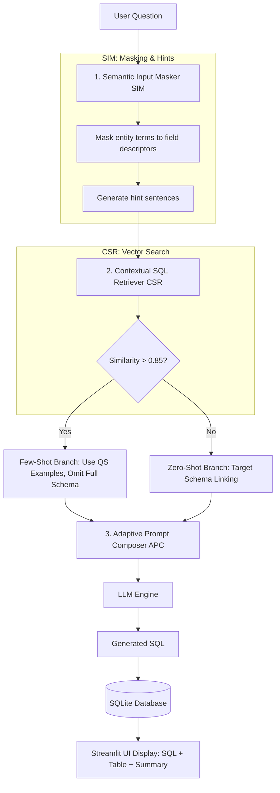

# 🚀 ADEPT-SQL Demo Guide & Documentation

This repository contains the complete implementation of **ADEPT-SQL** (*Adaptive Dynamic Enhanced Prompt Text-to-SQL*), based on the ACL 2025 research paper.

---

## ⚡ Quick Fix for the Command Error

If typing `streamlit run Home.py` gives an error:
> `streamlit : The term 'streamlit' is not recognized...`

Always run it using **`python -m streamlit`** instead:

```bash
python -m streamlit run Home.py
```

---

## 📋 Complete Step-by-Step Demo Procedure

Follow these exact steps during your demonstration:

### Step 1: Run Automated Verification Tests (10 Seconds)

Before opening the browser, show your evaluators that all system components pass unit tests:

```bash
python test_adept.py
```

**Expected Console Output**:
```text
=== 1. DB Module (opDB) ===
  [PASS] | schema_df not empty - 99 rows
  [PASS] | Booking count > 0 - count=15

=== 2. SIM Module (user_input_process) ===
  [PASS] | 'Blake' masked in trans - trans='Did [customer name] book [store name]?'

=== 3. Embedding Module (call_emb) ===
  [PASS] | Embedding returns list

=== 4. CSR Module (similarity_cal) ===
  [PASS] | Few-shot triggered (found similar)

Total: 32 passed, 0 failed out of 32 tests.
SUCCESS: All tests passed! ADEPT-SQL is ready.
```

---

### Step 2: Launch the Web Interface

Run the command in your PowerShell / Terminal:

```bash
python -m streamlit run Home.py
```

Your web browser will automatically open to `http://localhost:8501`.

---

### Step 3: Configure Settings in the Web UI

1. On the left sidebar, click **`1-Settings`**.

2. **LLM Section**:
   - **Model Name**: Enter `deepseek/deepseek-chat-v3-0324:free` (or `gpt-4o-mini` / `qwen2.5:7b`)
   - **URL**: Enter `https://openrouter.ai/api/v1/chat/completions` (or your local Ollama endpoint)
   - **API Key**: Enter your OpenRouter / OpenAI API key
   - Click **Connect** → Expect message: `✅ Connection success!`

3. **Embedding Model Section**:
   - Leave Model Name as `local model`
   - Click **Connect** → Expect message: `Connection success! Vector length: 384`

4. **DataSource Section**:
   - Select **Turtorial DB**
   - Click **Connect** → Connects to SQLite database `cre_Drama_Workshop_Groups.sqlite`.

---

### Step 4: Give the Live Demo (Chatting with Database)

Click **`3-StartChat`** on the left sidebar. Type these sample questions into the chat box:

---

#### 🧪 Question 1: Terminology Alignment & Few-Shot Imitation

**Type in Chat Box**:
```text
Did Blake book Adan Dinning?
```

**What is happening behind the scenes?**
1. **SIM (Semantic Input Masker)** recognizes `"Blake"` as a customer name and `"Adan Dinning"` as a store name. Masks the question to: `Did [customer name] book [store name]?`
2. **CSR (Contextual SQL Retriever)** searches stored queries in `backend/qvec.csv` and finds a similarity score of **1.0000** (High match > 0.85).
3. **APC (Adaptive Prompt Composer)** selects **Few-Shot Branch**, using historical examples while **omitting full schema dumps**.

**Expected Outputs in UI**:
- **Answer**: `"Yes, Blake has a booking at Adan Dinning. The booking ID is 1 and its current status is 'good'."`
- **Generated SQL** *(click 'View Generated SQL')*:
  ```sql
  SELECT B.Booking_ID, C.Customer_Name, S.Store_Name, B.Status_Code 
  FROM Bookings B 
  INNER JOIN Customers C ON B.Customer_ID = C.Customer_ID 
  INNER JOIN Stores S ON B.Store_ID = S.Store_ID 
  WHERE C.Customer_Name = 'Blake' AND S.Store_Name = 'Adan Dinning'
  ```
- **Table Result**:
  | Booking_ID | Customer_Name | Store_Name | Status_Code |
  | :--- | :--- | :--- | :--- |
  | 1 | Blake | Adan Dinning | good |

---

#### 🧪 Question 2: Complex Aggregation Query

**Type in Chat Box**:
```text
Which customer has the most bookings?
```

**What is happening behind the scenes?**
Matches historical aggregation patterns to build a `COUNT() ... GROUP BY ... ORDER BY ... LIMIT 1` SQL query.

**Expected Output**:
- **Generated SQL**:
  ```sql
  SELECT C.Customer_Name, COUNT(B.Booking_ID) AS booking_count
  FROM Customers C
  INNER JOIN Bookings B ON C.Customer_ID = B.Customer_ID
  GROUP BY C.Customer_Name
  ORDER BY booking_count DESC
  LIMIT 1
  ```
- **Table Result**: Displays the top customer's name and total booking count.

---

#### 🧪 Question 3: Unseen Query & Zero-Shot Schema Linking

**Type in Chat Box**:
```text
List all performers and their contact details.
```

**What is happening behind the scenes?**
1. No historical Question-SQL pair matches this question pattern ($< 0.85$ similarity).
2. CSR automatically switches to the **Zero-Shot Branch**.
3. APC performs **Focused Target Schema Linking** — passing only the relevant `Performers` table schema to keep prompt size minimal and precise.

**Expected Output**:
- **Generated SQL**:
  ```sql
  SELECT Customer_Name, Customer_Phone, Customer_Email_Address 
  FROM Performers 
  ORDER BY Customer_Name
  ```
- **Table Result**: Displays all performer names, phone numbers, and email addresses.

---

## 🏗️ Architecture Overview



---

## 🛠️ Summary of Project Files

- **`Home.py`**: Streamlit landing page.
- **`pages/1-Settings.py`**: Configuration tab for LLM, Embedding, and Database connections.
- **`pages/2-Review.py`**: Metadata inspector showing database schema, terminology dictionaries, and vector stores.
- **`pages/3-StartChat.py`**: Chat interface for submitting queries and displaying SQL + execution tables.
- **`user_input_process.py`**: SIM Module (handles terminology alignment and date masking).
- **`similarity_cal.py`**: CSR Module (handles vector similarity search).
- **`prompt_templates.py`**: APC Module (handles Few-Shot and Zero-Shot prompt generation).
- **`opDB.py`**: Database engine and dynamic DDL schema extractor.
- **`run.py`**: Main orchestrator running the full pipeline end-to-end.
- **`seed_qvec.py`**: Vector store generator for Question-SQL pairs.
- **`test_adept.py`**: Automated test suite (32 unit/integration tests).
