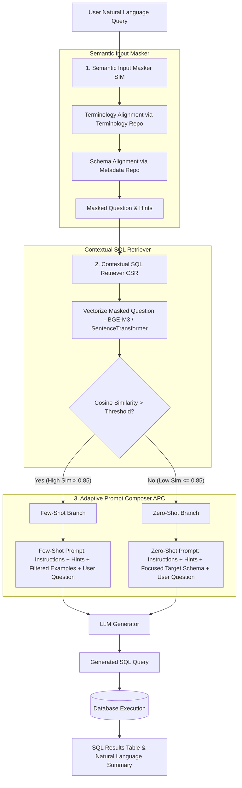

# ADEPT-SQL Implementation Plan

## Architectural Overview & Paper Understanding

**ADEPT-SQL** (*Adaptive Dynamic Enhanced Prompt Text-to-SQL*) is a domain-adapted Text-to-SQL framework designed for real-world enterprise databases. It tackles three major challenges in industrial Text-to-SQL deployments:
1. **Domain Knowledge Barriers**: Industry-specific acronyms (e.g., "CDU-I"), nominal terms, and complex metric logic that general LLMs lack out of the box.
2. **Semantic Schema Complexity**: Opaque table/column naming conventions (`PDO_23A`), versioned/overlapping tables (`prod_2023v2` vs `rpt_refinery_23`), and prompt length overload from massive enterprise schemas (100+ tables).
3. **Computational Constraints**: Large LLMs (175B+) are cost/latency prohibitive, whereas smaller models (<13B / 7B like `Qwen2.5-7B`) struggle when given raw, bloated schemas.

### The 3 Core Modules of ADEPT-SQL

1. **Semantic Input Masker (SIM)**:
   - Replaces domain terminology with canonical field descriptors.
   - Generates explicit **Hint Sentences** (e.g., `Word [CDU-I] is a value of field [UNIT_ALIAS]`).
   - Produces a **Masked Question** replacing specific entity names with standard schema field descriptions.

2. **Contextual SQL Retriever (CSR)**:
   - Stores historical, verified Question-SQL (QS) pairs in a vector database / matrix.
   - Computes embedding similarity (Cosine / L2 distance) between the vectorized *masked question* and stored QS entries.
   - Filters out duplicates and matches context regardless of entity variations.

3. **Adaptive Prompt Composer (APC)**:
   - **Few-Shot Prompting**: Used when CSR similarity $> \text{threshold}$ (default `0.85`). Incorporates retrieved QS pairs as in-context learning (ICL) examples and *omits* the large database schema to prevent schema noise.
   - **Zero-Shot Prompting**: Used when no similar QS pairs exist. Dynamically selects only target-relevant tables and fields (via hint terms and query vocabulary overlap) to keep prompt context clean and focused.

---

## Repository Audit: Current Code vs. Needed Implementation

We have cloned and audited the original repository (`ADEPT-SQL-Demo`). Here is our assessment:

| Feature / Component | Status in Cloned Repo | Requirements for Production Implementation |
| :--- | :--- | :--- |
| **Streamlit Interface** | Basic 3-page layout (`Home.py`, `pages/*`) | Enhance layout, add error handling, support custom DB connections & OpenAI/Ollama/Groq API keys |
| **Semantic Input Masking (`user_input_process.py`)** | Simple substring match with static CSV (`term.csv`) | Add regex-based date pattern masking + case-insensitive dynamic lookup engine |
| **Vector Similarity (`similarity_cal.py`)** | Static CSV vector matrix + hardcoded remote embedding IP | Implement flexible embedding pipeline using `sentence-transformers` locally, with fallback to API embeddings |
| **Prompt Composer (`prompt_templates.py`)** | Basic string templates for Few-Shot & Zero-Shot | Refine prompt structure, enforce strict SQL output formatting, support system instruction overrides |
| **Schema Parser & DB Engine (`opDB.py`)** | Basic SQLite query executor | Add dynamic DDL/schema extractor directly from SQLite databases without requiring manual `dbmata.csv` |
| **End-to-End Orchestrator (`run.py`)** | Basic script with hardcoded IP endpoints | Make end-to-end execution configurable via environment variables and robust retry/error handling |

---

## User Review Required

> [!IMPORTANT]
> **Key Decisions & Requirements:**
> 1. **LLM Provider Options**: The repo defaulted to a local vLLM endpoint (`10.29.253.101:19997`). We will add universal support for **OpenAI APIs**, **Ollama (local)**, **Groq/DeepSeek**, and **Custom vLLM endpoints**.
> 2. **Embedding Model**: The demo uses `m3e-base` or remote embedding API. We will implement `sentence-transformers` (`all-MiniLM-L6-v2` or `m3e-base` when downloaded) with optional fallback to TF-IDF or API embeddings so it runs out-of-the-box on any hardware.
> 3. **Automatic Schema Extraction**: We will add a dynamic SQLite schema inspection module so users can point ADEPT-SQL to *any* `.sqlite` database file without manually generating `dbmata.csv`.

---

## Proposed Changes

### Core Backend & Pipeline Refactoring

#### [MODIFY] [user_input_process.py](file:///c:/nlp_case_study/user_input_process.py)
- Improve `term_recognition` and `time_recognition` regex logic.
- Make terminology mapping configurable from SQLite/JSON dynamically.

#### [MODIFY] [call_emb.py](file:///c:/nlp_case_study/call_emb.py)
- Implement robust local embedding loader using `sentence-transformers` with graceful fallback.
- Support HuggingFace / OpenAI embedding APIs.

#### [MODIFY] [call_llm.py](file:///c:/nlp_case_study/call_llm.py)
- Refactor `callLLM` to support standard OpenAI-compatible endpoints (OpenAI, DeepSeek, vLLM, Ollama, Groq).
- Add response parsing to extract clean SQL statements without markdown backtick artifacts.

#### [MODIFY] [similarity_cal.py](file:///c:/nlp_case_study/similarity_cal.py)
- Ensure dynamic vector indexing for Question-SQL pairs using cosine similarity.
- Handle fallback when no vectors or embedding models are active.

#### [MODIFY] [prompt_templates.py](file:///c:/nlp_case_study/prompt_templates.py)
- Update Zero-Shot and Few-Shot templates matching the paper's exact specification in Appendix B.
- Ensure clear structural guidance for small LLMs.

#### [MODIFY] [opDB.py](file:///c:/nlp_case_study/opDB.py)
- Add schema metadata extraction helper (`get_table_schema`, `get_column_comments`) directly from SQLite DDL.

#### [MODIFY] [run.py](file:///c:/nlp_case_study/run.py)
- Provide clean CLI runner and API function for end-to-end Text-to-SQL processing.

#### [NEW] [test_adept.py](file:///c:/nlp_case_study/test_adept.py)
- Automated unit test suite to verify SIM masking, CSR retrieval, APC prompt construction, LLM calling, and SQL execution on sample databases (`cre_db` and `prod_db`).

---

## Verification Plan

### Automated Tests
1. **Unit & Integration Tests (`python test_adept.py`)**:
   - Test `user_input_init` masking logic on sample inputs.
   - Test `search_qvec` cosine similarity calculation on stored questions.
   - Test `Prompt_Fewshot` vs `Prompt_Zeroshot` branch selection based on 0.85 threshold.
   - Test SQL generation & execution against `cre_Drama_Workshop_Groups.sqlite`.

### Manual & UI Verification
1. **Streamlit Interactive UI Check**:
   - Run `streamlit run Home.py` on local port.
   - Verify Settings connection checks, candidate QS review, and Chat interface.
